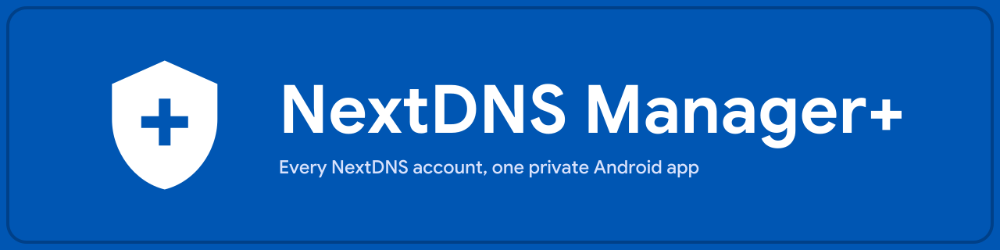

<div align="center">
  

  <h3>Every NextDNS account in one small, private Android app.</h3>

  <p>
    <a href="../../releases/latest"><picture><source media="(prefers-color-scheme: dark)" srcset="artwork/readme/get-github-dark.svg"></picture></a>
    <!-- Un-comment when the app is listed (fdroid.md), and put the public repository's address into the Obtainium link:
    <a href="https://f-droid.org/packages/org.rafee_m.nextdnsmanagerplus/"><picture><source media="(prefers-color-scheme: dark)" srcset="artwork/readme/get-fdroid-dark.svg"></picture></a>
    <a href="https://apps.obtainium.imranr.dev/redirect?r=obtainium://add/https://github.com/OWNER/REPO"><picture><source media="(prefers-color-scheme: dark)" srcset="artwork/readme/get-obtainium-dark.svg"></picture></a>
    -->
  </p>
  <p>
    <picture><source media="(prefers-color-scheme: dark)" srcset="artwork/readme/chip-android-dark.svg"></picture>
    <picture><source media="(prefers-color-scheme: dark)" srcset="artwork/readme/chip-webview-dark.svg"></picture>
    <a href="../../releases/latest"><picture><source media="(prefers-color-scheme: dark)" srcset="artwork/readme/chip-release-dark.svg"></picture></a>
    <picture><source media="(prefers-color-scheme: dark)" srcset="artwork/readme/chip-apk-dark.svg"></picture>
    <a href="LICENSE"><picture><source media="(prefers-color-scheme: dark)" srcset="artwork/readme/chip-license-dark.svg"></picture></a>
  </p>

  <p>
    The NextDNS dashboard with a native top bar: several accounts signed in side by side, a live<br>
    "am I using NextDNS?" icon, app lock and find in page, in an app of about 190 KB.
  </p>

  <p>
    <a href="#features"><b>Features</b></a> ·
    <a href="#what-the-app-adds-and-what-webview-decides"><b>WebView</b></a> ·
    <a href="#download"><b>Download</b></a> ·
    <a href="#privacy"><b>Privacy</b></a> ·
    <a href="BUILDING.md"><b>Build it yourself</b></a> ·
    <a href="#license"><b>License</b></a>
  </p>
</div>

---

## Why NextDNS Manager+?

Managing more than one NextDNS account on a phone means signing out and in again, or a browser full of private tabs.
NextDNS Manager+ keeps each account in its own sealed container, so they stay signed in **at the same time** and never
see each other's data; one tap on the numbered chip in the top bar switches between them, and the page you left is
still there when you come back.

It shows the real NextDNS dashboard, so every setting, list and log the website has is there, and nothing has to wait
for an app update when NextDNS adds something. Around it the app adds what a browser tab can't: the connection-status
icon, app lock, a clean theme that follows the dashboard, and one-tap tools for testing your setup.

> **Status:** early development (version 0.1). Built, unit-tested and linted on every change; **not yet tested on a
> phone by the developer**. Expect rough edges and please [report them](../../issues/new/choose).

## Features

### Several accounts, side by side
- **Up to 20 NextDNS accounts**, each signed in separately in its own container (cookies, storage and cache never mix).
- **Numbered account chip** in the top bar: tap to switch; the menu shows which accounts are loaded and lets you
  close one, and has Reload, Desktop site, Hide status bar and Clear cache at hand.
- **Accounts kept loaded:** choose 1–10 (default 3). Switching between loaded accounts is instant; the one used
  longest ago is closed first and reopens from its cache when you pick it again.
- Rename, reorder (drag), sign out or remove accounts in Settings. Signing out or removing deletes that account's data
  on the phone.

### Knows whether NextDNS is working
- **Connection-status icon:** green tick when this phone uses NextDNS with encryption, warning sign otherwise; tap it
  for the explanation. It checks when the network changes, only while the app is on screen.
- **Ping test** (NextDNS's own ping and test pages) and a **Private DNS shortcut** to Android's network settings.

### Private and locked
- **App lock** with your fingerprint, face or screen-lock PIN; it asks again after a minute away. While it is on,
  screenshots and the recent-apps preview of the app are blank.
- No ads, no analytics, no crash reporting, no Google Play Services. See [Privacy](#privacy).

### Made for Android
- **White, Black or Match system** theme for the app, which asks the dashboard to match; the status bar takes the
  page's colour (or hide the status bar).
- **Find in page**, **desktop site** per account, **pinch to zoom** (the dashboard normally forbids it).
- **Two-factor recovery codes** are saved to Downloads; other downloads (Apple configuration profile, log export) open
  in your browser.
- **Clear cache** for every account at once, without signing anyone out; Settings shows how much space it uses.
- One library (AndroidX WebKit), about 190 KB to download.

## What the app adds, and what WebView decides

NextDNS Manager+ shows the website in **Android System WebView**, the browser engine your phone already has. Some
features depend on that engine's version, not on the app:

| Feature | Needs | Without it |
|---|---|---|
| **Several accounts** (one container each) | WebView **119 or newer** (WebView "profiles") | one account only; Settings says so. Update *Android System WebView* through your app store |
| Cache limit of 20 MB per account | a WebView with cache control | WebView uses its own limit |
| Find-in-page matches in the app's colour | WebView 144 or newer | Chromium's yellow/orange highlight |
| Desktop site and pinch to zoom from the first frame | a WebView that runs scripts at page start | applied right after the page loads |

What stays the **website's** job: the dashboard's look, settings, logs and analytics, and its own dark mode. The app
asks the dashboard to follow the app's theme, but NextDNS decides how its pages look. If NextDNS changes its site, the
app shows the new version at once.

**Battery:** pages of accounts you aren't looking at are paused, and loaded accounts are limited by *Accounts kept
loaded*. The dashboard itself stops its background checks when it isn't visible, and switches off the live log stream
after 5 minutes without activity.

## Download

<p align="center">
  <a href="../../releases/latest"><picture><source media="(prefers-color-scheme: dark)" srcset="artwork/readme/get-github-dark.svg"></picture></a>
</p>

- **Requirements:** Android 10 or newer and a NextDNS account. Several accounts need *Android System WebView* 119+.
- **What's new:** each [release](../../releases) lists its changes (also in
  [`fastlane/…/changelogs`](fastlane/metadata/android/en-US/changelogs) once the first release is out).
- **F-Droid:** planned; what it takes is in [`fdroid.md`](fdroid.md).

## Privacy

- The app talks only to **NextDNS**: the dashboard you open, and one small request to `test.nextdns.io` when you open
  the app or your network changes (for the status icon; it carries no account data).
- No analytics, tracking or crash reports; WebView's own usage statistics are switched off.
- Your logins stay on the phone, in each account's container, and are left out of Android's backups.
- Links to other websites open in your browser, never inside an account.

Not affiliated with or endorsed by NextDNS. "NextDNS" is a trademark of its owner.

## Build it yourself

Everything you need (JDK, Android SDK, tests, checks, reproducible builds) is in **[BUILDING.md](BUILDING.md)**. The
short version:

```bash
./gradlew assembleDebug        # app/build/outputs/apk/debug/
```

How releases are made and signed: [RELEASE.md](RELEASE.md). How the app is put together and how to change it:
[PROJECT.md](PROJECT.md). What changed: [CHANGES.md](CHANGES.md).

## Credits

Built on [NextDNS Manager](https://github.com/doubleangels/nextdnsmanager) by doubleangels (the original app) and
[LLM Central](https://github.com/UpperPanda1/assist) by Rafee-M (accounts, tabs, settings). Icons: Material Icons
(Apache License 2.0) and [Simple Icons](https://simpleicons.org) (CC0); the README badges follow the design of
[Flow](https://github.com/Flow-Tube/Flow)'s, re-drawn by `tools/readme-badges` in NextDNS blue.

## License

Free software under the [GNU General Public License v3.0](LICENSE).
